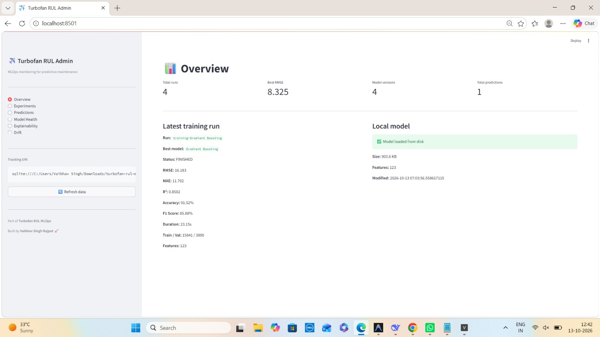
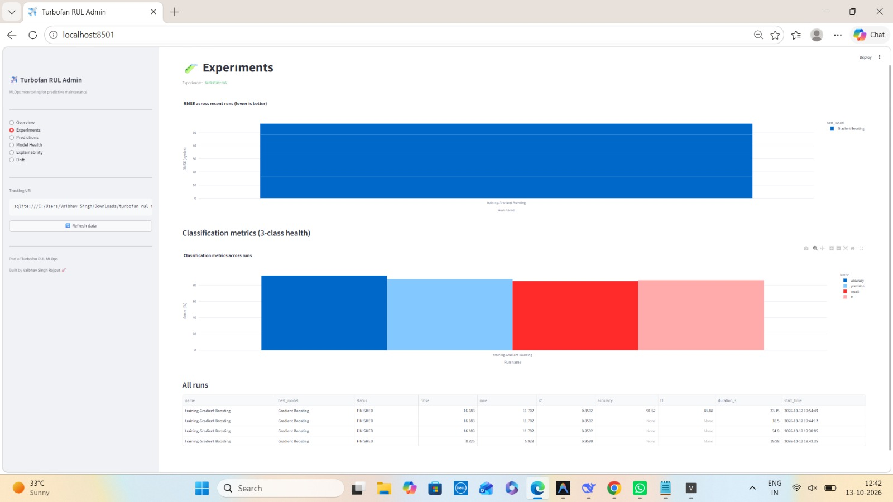
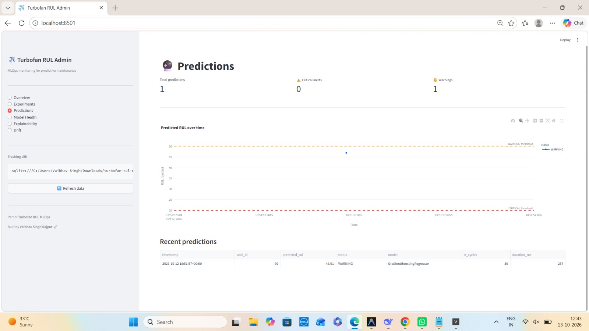
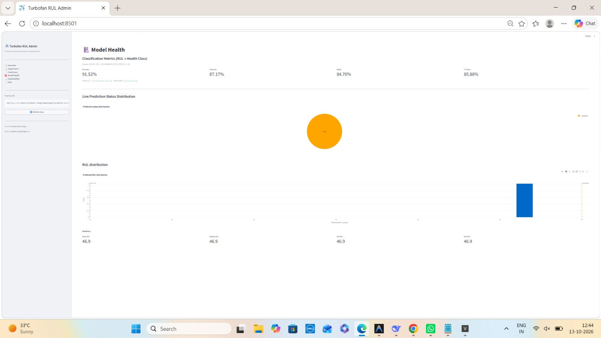
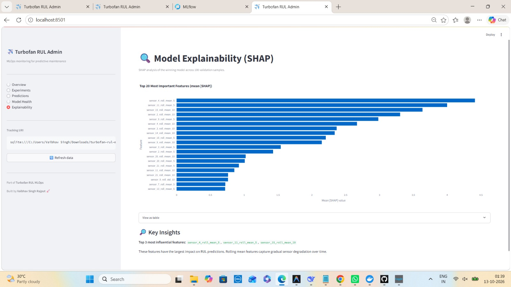
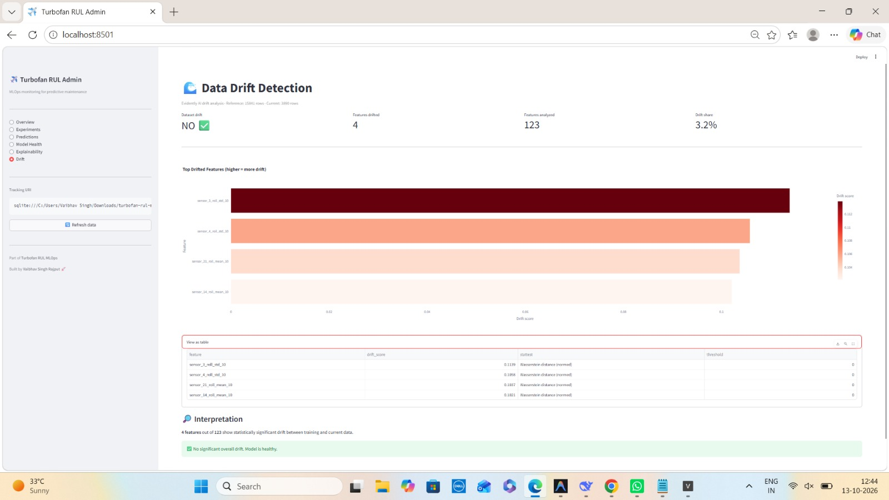

# ✈️ Turbofan RUL MLOps

### End-to-End Predictive Maintenance Platform for Jet Engines

<p align="center">
  <strong>Predict Remaining Useful Life. Detect Drift. Prevent Failures. Save Millions.</strong>
</p>

<p align="center">
  🌐 <a href="https://turbofan-rul-mlops.onrender.com"><b>Live Demo</b></a> •
  📘 <a href="https://turbofan-rul-mlops.onrender.com/docs"><b>API Docs</b></a> •
  📊 <a href="https://turbofan-vaibhav.streamlit.app"><b>Admin Dashboard</b></a> •
  🔬 <a href="https://dagshub.com/vaibhav07772/turbofan-rul-mlops/experiments"><b>MLflow (DagsHub)</b></a>
</p>

<p align="center">
  
  
  
  
  
  
  
  
  
  
  
  
</p>

---

## 🚀 Overview

**Turbofan RUL MLOps** is a production-grade predictive maintenance platform that predicts the **Remaining Useful Life (RUL)** of jet engines using NASA's C-MAPSS Turbofan Engine Degradation dataset.

The platform combines a **FastAPI backend**, a **Streamlit admin dashboard**, a modular **ML pipeline**, and a full **MLOps stack** — including experiment tracking with **MLflow (local + DagsHub remote)**, data versioning with **DVC**, drift detection with **Evidently AI**, model explainability with **SHAP**, and Prometheus monitoring.

It turns raw sensor data into **actionable maintenance decisions** — preventing failures before they happen.

---

## ✨ Key Features

### 🧠 Machine Learning
- **3-model benchmarking** — Random Forest, XGBoost, Gradient Boosting compete on every training run
- **RUL regression** — Predicts remaining useful life in cycles (capped at 125 for piecewise-linear target)
- **3-class health classification** — HEALTHY (>50), WARNING (20-50), CRITICAL (<20)
- **Time-series feature engineering** — 123 features (rolling means, stds, lags, diffs)
- **Engine-level train/val split** — prevents data leakage

### 🔬 MLOps
- **MLflow tracking** — Local SQLite + **DagsHub remote** for cloud experiments
- **Model Registry** — `turbofan-rul-model` auto-versioned with each retrain
- **DVC data versioning** — Real NASA C-MAPSS dataset tracked with `dvc.lock`
- **Pandera schema validation** — Strict dtype/range/null checks on uploads
- **Drift detection (Evidently AI)** — Statistical comparison against training distribution
- **Model explainability (SHAP)** — Top feature importance charts
- **Structured logging (structlog)** — JSON logs with request IDs
- **Prometheus metrics** — `/metrics` endpoint with HTTP, prediction, and training metrics
- **Prediction audit logs** — JSONL trail for every prediction

### 🖥️ Product Surface
- **REST API** — Upload CSV, get RUL prediction + health class
- **Admin dashboard** — 6-tab monitoring: Overview, Experiments, Predictions, Model Health, Explainability, Drift
- **Docker support** — Containerized deployment

### 🛠️ Engineering
- **29 automated tests** — pytest suite covering API, pipeline, classification, drift
- **CI/CD** — GitHub Actions lint + test + Docker build
- **Pre-commit hooks** — Ruff linting + formatting
- **Production-ready** — Deployed on Render + Streamlit Cloud

---

## 📸 Screenshots

### Admin Dashboard — Overview


### Experiments — Model Comparison


### Predictions — Live Forecasts


### Model Health — Classification Metrics


### Explainability — SHAP Feature Importance


### Drift Detection — Evidently AI


---

## 🏗️ System Architecture

```text
                    Sensors (NASA C-MAPSS)
                            │
                            ▼
                    FastAPI Upload API
                            │
                            ▼
                    Pandera Validation
                            │
                            ▼
                  Data Pipeline (DVC)
              ┌─────────────┼─────────────┐
              ▼             ▼             ▼
        Preprocessing  Feature Engg.  Segmentation
              │             │             │
              └─────────────┼─────────────┘
                            ▼
                  Time-Series Model Training
              ┌─────────────┼─────────────┐
              ▼             ▼             ▼
        Random Forest   XGBoost    Gradient Boosting
              │             │             │
              └─────────────┼─────────────┘
                            ▼
              MLflow Tracking (Local + DagsHub)
                            │
                            ▼
                  Best Model → Model Registry
                            │
              ┌─────────────┼─────────────┐
              ▼             ▼             ▼
         Prediction     Prometheus    SHAP +
           API          Metrics      Evidently
              │             │             │
              └─────────────┼─────────────┘
                            ▼
                  Streamlit Admin Dashboard
              (6 tabs: Overview, Experiments,
               Predictions, Health, SHAP, Drift)
```

---

## 🛠️ Tech Stack

| Layer | Technology |
| --- | --- |
| **Backend** | Python 3.11, FastAPI, Uvicorn, Pydantic v2 |
| **ML** | scikit-learn, XGBoost, pandas, NumPy |
| **MLOps** | MLflow (local + DagsHub), DVC, Pandera, Evidently AI, SHAP |
| **Admin UI** | Streamlit, Plotly |
| **Monitoring** | Prometheus client, `/metrics` endpoint |
| **Logging** | structlog (JSON logs) |
| **Testing** | pytest, pytest-cov (29 tests) |
| **Linting** | Ruff, pre-commit |
| **CI/CD** | GitHub Actions |
| **Containerization** | Docker |
| **Deployment** | Render (app), Streamlit Cloud (admin), DagsHub (MLflow) |

---

## 📂 Project Structure

```text
turbofan-rul-mlops/
│
├── admin/                          # Streamlit admin dashboard
│   ├── app.py                      # 6-tab dashboard
│   └── requirements.txt
│
├── app/
│   ├── mlops/
│   │   ├── mlflow_utils.py         # MLflow tracking (local + DagsHub)
│   │   └── explainability.py       # SHAP integration
│   │
│   ├── monitoring/
│   │   ├── metrics.py              # Prometheus metrics
│   │   ├── predictions.py          # Prediction logs
│   │   └── drift.py                # Evidently AI drift detection
│   │
│   ├── pipeline/
│   │   ├── schema.py               # Pandera schema (26 columns)
│   │   ├── data_loader.py          # NASA C-MAPSS loader
│   │   ├── test_loader.py          # Test data + RUL
│   │   ├── preprocessing.py        # Drop flat sensors, split by engine
│   │   ├── features.py             # 123 rolling/lag features
│   │   ├── models.py               # RF, XGBoost, GB builders
│   │   ├── training.py             # Training + classification metrics
│   │   ├── classification.py       # RUL → health class
│   │   └── inference.py            # Model loader + predict
│   │
│   ├── config.py                   # Settings (SQLite + DagsHub)
│   ├── logging_config.py           # structlog
│   ├── middleware.py               # Request ID + metrics
│   └── main.py                     # FastAPI endpoints
│
├── data/
│   ├── raw/                        # NASA data (DVC-tracked)
│   ├── models/                     # model.pkl, shap_importance.json, drift_report.json
│   └── logs/                       # predictions.jsonl
│
├── docs/                           # Screenshots
│
├── scripts/
│   ├── make_sample_data.py         # Synthetic data gen
│   ├── train.py                    # Training CLI
│   ├── compute_shap.py             # SHAP analysis
│   ├── compute_drift.py            # Drift detection
│   └── test_dagshub.py             # DagsHub connection test
│
├── tests/
│   ├── test_api.py                 # API tests
│   ├── test_pipeline.py            # Pipeline tests
│   ├── test_classification.py      # Classification tests
│   └── test_drift.py               # Drift tests
│
├── .github/workflows/ci.yml
├── .env.example
├── .dvc/                           # DVC metadata
├── Dockerfile
├── dvc.yaml
├── pyproject.toml
├── pytest.ini
├── requirements.txt
├── requirements-dev.txt
├── runtime.txt
└── README.md
```

---

## ⚙️ Getting Started

### Prerequisites
- Python **3.11**
- Git
- Docker Desktop (optional)

### 1. Clone

```bash
git clone https://github.com/vaibhav07772/turbofan-rul-mlops.git
cd turbofan-rul-mlops
```

### 2. Virtual environment

**Windows**
```powershell
python -m venv .venv
.\.venv\Scripts\Activate.ps1
```

**macOS / Linux**
```bash
python3 -m venv .venv
source .venv/bin/activate
```

### 3. Install dependencies

```bash
pip install -r requirements-dev.txt
pre-commit install
```

### 4. Configure (optional)

```bash
cp .env.example .env
# Edit .env to add DagsHub MLflow credentials for remote tracking
```

### 5. Generate sample data (or download real NASA dataset)

```bash
python scripts/make_sample_data.py
```

**For real data:** [NASA C-MAPSS from Kaggle](https://www.kaggle.com/datasets/behrad3d/nasa-cmaps) → save to `data/raw/`.

### 6. Train the model

```bash
python scripts/train.py
```

### 7. Run the API

```bash
python run.py
```

- **Dashboard:** http://127.0.0.1:8000
- **API Docs:** http://127.0.0.1:8000/docs
- **Metrics:** http://127.0.0.1:8000/metrics

### 8. Run the admin dashboard

```bash
streamlit run admin/app.py
```

- **Admin:** http://localhost:8501 (6 tabs)

---

## 🔬 MLflow — Experiment Tracking & Model Registry

Every training run logs to MLflow. Two backends supported:

### Local (SQLite)
```bash
mlflow ui --backend-store-uri sqlite:///mlflow.db --port 5000
```

### Remote (DagsHub)
Add to `.env`:
```env
MLFLOW_TRACKING_URI=https://dagshub.com/vaibhav07772/turbofan-rul-mlops.mlflow
MLFLOW_TRACKING_USERNAME=vaibhav07772
MLFLOW_TRACKING_PASSWORD=<your-token>
```

View experiments at: **[DagsHub MLflow](https://dagshub.com/vaibhav07772/turbofan-rul-mlops/experiments)**

**Logged per run:**
- Params: `n_train`, `n_val`, `n_features`, candidate models, best hyperparameters
- Regression metrics: `rmse`, `mae`, `r2`
- Classification metrics: `accuracy`, `precision`, `recall`, `f1`
- Artifacts: serialized sklearn model + signature
- Registry: `turbofan-rul-model` (auto-versioned)

---

## 📊 Admin Dashboard (6 Tabs)

| Tab | What It Shows |
| --- | --- |
| **Overview** | Total runs, RMSE, accuracy, model version, latest run details |
| **Experiments** | RMSE bar chart + classification grouped bar + runs table |
| **Predictions** | Live prediction timeline with thresholds, audit log |
| **Model Health** | Accuracy/Precision/Recall/F1 cards, status pie, RUL histogram |
| **Explainability** | SHAP top-20 features (which sensors matter most) |
| **Drift** | Evidently AI drift share, drifted features, dataset health |

---

## 🌊 Drift Detection (Evidently AI)

```bash
python scripts/compute_drift.py
```

Compares training distribution against validation/current data. Reports drifted features with statistical tests (Wasserstein distance, KS, Chi-square).

---

## 🔍 Model Explainability (SHAP)

```bash
python scripts/compute_shap.py
```

Computes SHAP values using `TreeExplainer` on the best model. Outputs top-N most important features.

**Example (real NASA data):** Top features are `sensor_4_roll_mean_5`, `sensor_11_roll_mean_5`, `sensor_15_roll_mean_10` — matching NASA documentation.

---

## 🔌 API Reference

| Method | Endpoint | Purpose |
| --- | --- | --- |
| `GET` | `/` | Home |
| `GET` | `/metrics` | Prometheus metrics |
| `GET` | `/health` | Service health |
| `GET` | `/health/live` | Liveness probe |
| `GET` | `/health/ready` | Readiness probe |
| `POST` | `/api/predict/upload` | CSV upload → RUL prediction |
| `POST` | `/api/predict` | JSON single-cycle prediction |

---

## 🧪 Running Tests

```bash
pytest -v
```

**29 tests** covering:
- API endpoints (10)
- Pipeline & schema (9)
- Classification (7)
- Drift detection (3)

---

## 🐳 Docker

```bash
docker build -t turbofan-rul-mlops .
docker run --rm -p 8000:8000 turbofan-rul-mlops
```

---

## ⚙️ Configuration Reference

All settings in `.env` (see `.env.example`):

| Variable | Default | Purpose |
| --- | --- | --- |
| `ENVIRONMENT` | `development` | Deployment environment |
| `LOG_LEVEL` | `INFO` | Logging level |
| `LOG_JSON` | `false` | JSON logs (production) |
| `MLFLOW_ENABLED` | `true` | Toggle tracking |
| `MLFLOW_TRACKING_URI` | `sqlite:///mlflow.db` | Local SQLite or DagsHub URL |
| `MLFLOW_TRACKING_USERNAME` | `` | DagsHub username (remote only) |
| `MLFLOW_TRACKING_PASSWORD` | `` | DagsHub token (remote only) |
| `MLFLOW_EXPERIMENT_NAME` | `turbofan-rul` | Experiment name |
| `MLFLOW_REGISTERED_MODEL_NAME` | `turbofan-rul-model` | Registry model name |

---

## 🚀 Deployment

### Main App → Render

1. Push to GitHub
2. Render → **New Web Service** → connect repo
3. **Build:** `pip install -r requirements.txt`
4. **Start:** `python run.py`
5. **Env vars:**
   ```
   ENVIRONMENT=production
   LOG_JSON=true
   MLFLOW_ENABLED=true
   MLFLOW_TRACKING_URI=https://dagshub.com/vaibhav07772/turbofan-rul-mlops.mlflow
   MLFLOW_TRACKING_USERNAME=vaibhav07772
   MLFLOW_TRACKING_PASSWORD=<token>
   ```

### Admin Dashboard → Streamlit Cloud

1. https://share.streamlit.io → **New app**
2. Repo + branch: `main`
3. Main file: `admin/app.py`
4. Python version: `3.11`
5. Add secrets (`mlflow` section) for DagsHub auth

---

## 🗺️ Roadmap

- [x] Structured logging with request IDs
- [x] FastAPI prediction API
- [x] 3-model training with classification metrics
- [x] MLflow tracking (local SQLite)
- [x] DagsHub remote MLflow tracking
- [x] Model Registry (auto-versioned)
- [x] DVC data versioning (real NASA dataset)
- [x] Pandera schema validation
- [x] 29 automated tests + CI/CD
- [x] Dockerfile
- [x] Streamlit admin dashboard (6 tabs)
- [x] SHAP explainability
- [x] Evidently AI drift detection
- [ ] Auto-retraining pipeline
- [ ] Multi-dataset support (FD002, FD003, FD004)
- [ ] K8s deployment

---

## 🙏 Credits

**Dataset:** NASA C-MAPSS Turbofan Engine Degradation ([Kaggle](https://www.kaggle.com/datasets/behrad3d/nasa-cmaps))

**MLOps Platform built by** Vaibhav Singh Rajput

---

## 👨‍💻 Author

**Vaibhav Singh Rajput**
AI/ML Engineer | Machine Learning | MLOps | Generative AI

GitHub: [@vaibhav07772](https://github.com/vaibhav07772)

---

<p align="center">
  <strong>Turbofan RUL MLOps</strong><br>
  <em>From sensor data to actionable maintenance decisions.</em>
</p>